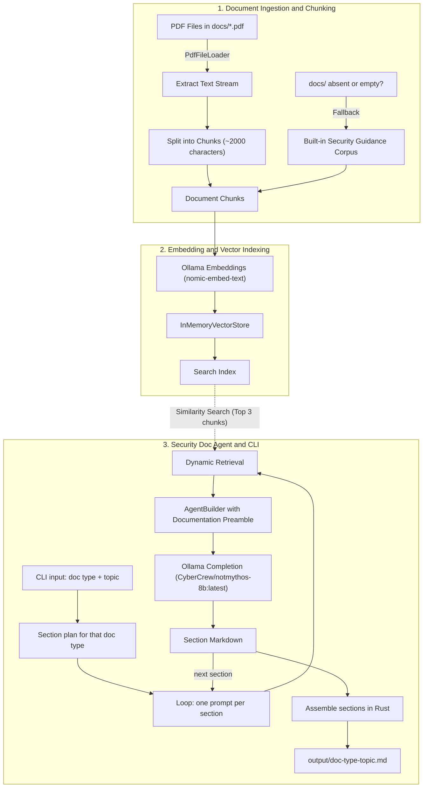

# Security DOC RAG

A local Rust agent that writes security documents. It uses the [Rig](https://github.com/0xPlaygrounds/rig) framework and [Ollama](https://ollama.com/).

The agent writes one document at a time. It writes one section per model call. This keeps each request small for the 8B model.

## Knowledge sources

The agent uses two sources only:

1. **Document knowledge:** chunks from the PDFs in `docs/`.
2. **Model knowledge:** `CyberCrew/notmythos-8b:latest`, run by Ollama.

Everything runs 100% locally. There are no API keys, no telemetry and no cloud services.

## Prerequisites

- [Rust](https://rustup.rs/) (2021 edition)
- [Ollama](https://ollama.com/), running on port 11434

Pull the two models:

```sh
ollama pull nomic-embed-text
ollama pull CyberCrew/notmythos-8b:latest
```

## Add your documents

Put your security PDFs in `docs/`. The agent loads `docs/*.pdf` at startup.

If `docs/` is missing or empty, the agent uses a small built-in security guidance corpus. It still runs.

## Usage

```sh
cargo run -- <doc-type> "<topic>"
```

Example:

```text
$ cargo run -- threat-model "payment API"
Loaded 18 security chunks.
Successfully generated embeddings
[1/6] Scope ... done
[2/6] Assets ... done
...
Saved output/threat-model-payment-api.md
```

If you give a wrong document type, the agent lists the valid types.

### Document types

| Key | Document |
| :--- | :--- |
| `threat-model` | Threat model |
| `secure-coding-guideline` | Secure coding guideline |
| `incident-response-runbook` | Incident response runbook |
| `hardening-checklist` | Hardening checklist |
| `vulnerability-remediation-report` | Vulnerability remediation report |

The output is a Markdown file in `output/`. Lines that come only from the model have the mark `(model knowledge)`. Uncertain lines say `needs review`.

### Environment overrides

| Variable | Default |
| :--- | :--- |
| `EMBED_MODEL` | `nomic-embed-text` |
| `COMPLETION_MODEL` | `CyberCrew/notmythos-8b:latest` |

Example:

```sh
COMPLETION_MODEL=my-model:latest cargo run -- hardening-checklist "Linux web server"
```

## Release build

Build the optimised binary:

```bash
cargo build --release
```

The release profile uses `opt-level = 3`, fat LTO, one codegen unit, `panic = "abort"` and `strip = true`. The binary is about 6.5 MiB. The debug binary is about 20 MiB.

Run the binary from the project folder. It reads `docs/` and writes `output/` there.

```bash
./target/release/security-doc-rag threat-model "payment API"
```

On Windows, use `target\release\security-doc-rag.exe`. On the author machine, `target/` is a Windows junction to `D:/cargo-target-bowfin` because drive C: is small. Recreate it with `mklink /J target <folder>`, or delete it to use a normal folder.

## Architecture



## File structure

```text
Security DOC RAG/
├── docs/                   # Your security PDFs
│   └── *.pdf
├── output/                 # Generated documents (git-ignored)
├── src/
│   ├── main.rs             # CLI, ingestion, index, agent, section loop
│   └── sections.rs         # Section plans for the five document types
├── Cargo.toml
├── Cargo.lock
├── .gitignore              # target/ and output/
└── README.md
```

## Tests

```sh
cargo test
```

## Review warning

> [!WARNING]
> Each generated document is a draft from an 8B model. A human must review it before use.
>
> The retrieved chunk IDs are not exposed by `dynamic_context`. The output names the model and the PDFs in general. It does not name exact sources.
