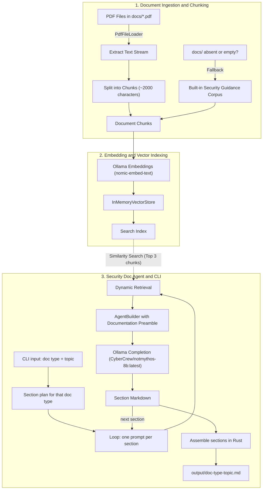

# Security Doc RAG

A new, standalone project: a local Rust agent built with the [Rig](https://github.com/0xPlaygrounds/rig) framework and [Ollama](https://ollama.com/) that does **one job**: write security documents (threat model, secure coding guideline, incident response runbook, hardening checklist, vulnerability remediation report).

It is separate from Security RAG: its own repo, its own `docs/` knowledge, its own index. It uses two knowledge sources only:

1. **Document knowledge:** chunks from this project's own `docs/*.pdf`.
2. **Model knowledge:** `CyberCrew/notmythos-8b:latest` through Ollama.

Everything runs 100% locally. No external API keys, telemetry or cloud services.

---

## Architecture & Workflow



### Detailed Pipeline Stages

1. **Document Loading:** at startup the app loads `docs/*.pdf` with `rig::loaders::PdfFileLoader`. If `docs/` is missing or empty, it falls back to a small built-in security guidance corpus so it still runs.
2. **Word-Boundary Chunking:** text is split by a `chunk_text` function into chunks of at most 2,000 characters on whitespace boundaries.
3. **Vector Embeddings:** each chunk becomes a `Document { id, content }` and is embedded through `EmbeddingsBuilder` with `nomic-embed-text`.
4. **In-Memory Vector Store:** embeddings are held in an `InMemoryVectorStore` and searched by cosine similarity.
5. **Section Plan:** each document type is a Rust `const` list of sections (title plus a one-line instruction). Example, threat model: Scope, Assets, Trust Boundaries, Threats (STRIDE), Mitigations, Residual Risk.
6. **Section-by-Section Generation:** for every section the agent gets a short prompt (doc type, topic, section title, instruction). `dynamic_context(3, index)` retrieves the top 3 matching chunks. One section per call keeps each request small for the 8B model.
7. **Documentation Preamble:** write for engineers in Markdown; use retrieved context first; fill gaps from model knowledge and mark those lines `(model knowledge)`; never invent CVE IDs, versions or commands; write `needs review` when unsure.
8. **Assembly:** Rust joins the sections, adds a header (type, topic, date, model) and writes `output/<type>-<topic>.md` with `std::fs`.

---

## Tech Stack & Dependencies

| Component | Technology | Description |
| :--- | :--- | :--- |
| **Language** | Rust (2021 Edition) | Memory-safe systems language (`forbid(unsafe_code)`) |
| **LLM Framework** | [Rig](https://github.com/0xPlaygrounds/rig) (v0.44, features `derive`, `pdf`) | `AgentBuilder`, `EmbeddingsBuilder`, `PdfFileLoader`, `InMemoryVectorStore` |
| **LLM Host** | [Ollama](https://ollama.com/) | Local runner on port 11434 |
| **Embedding Model** | `nomic-embed-text` | 768-dimensional embeddings |
| **Completion Model** | `CyberCrew/notmythos-8b:latest` | Local security-tuned model |
| **Vector Store** | `InMemoryVectorStore` | Ephemeral in-memory index |
| **Async Runtime** | Tokio (v1, full) | Asynchronous runtime |
| **Serialization** | Serde | Derive for `Document` |
| **Error Handling** | Anyhow | Context-rich errors |
| **File Output** | `std::fs` | Writes the Markdown document |

`Cargo.toml` uses the same dependencies as Security RAG: `rig`, `anyhow`, `serde`, `tokio`. Nothing else.

---

## File Structure

```
security-doc-rag/
├── docs/                   # Your security PDFs (this project's own knowledge)
│   └── *.pdf
├── output/                 # Generated documents (git-ignored)
├── src/
│   ├── main.rs             # CLI, ingestion, index, agent, section loop
│   └── sections.rs         # Section plans for the five document types
├── Cargo.toml
├── Cargo.lock
├── .gitignore              # target/ and output/
└── README.md
```

Run: `cargo run -- threat-model "payment API"`

---

## Implementation Phases

1. **Project setup (0.5 day):** `cargo new security-doc-rag`, copy the dependency block, add `docs/` and `output/`, pull `nomic-embed-text` and `CyberCrew/notmythos-8b:latest`. Confirm against Rig 0.44 that `AgentBuilder` accepts `.temperature()`, `.max_tokens()` and `.additional_params()` (for Ollama `num_ctx`). Run `ollama show` on the model to see its real context length.
2. **Ingestion and index (1 day):** write `chunk_text`, PDF loading with the built-in fallback, embedding and `InMemoryVectorStore`, with the same chunk tests as before.
3. **Section plans (0.5 day):** in `sections.rs`, define the five document types as `const` section lists.
4. **Documentation agent (1.5 days):** `AgentBuilder` with the documentation preamble, `dynamic_context(3, index)`, temperature about 0.35, `num_ctx` 8192. Add the per-section loop and the Markdown assembly.
5. **CLI and output (0.5 day):** parse `<doc-type> <topic>`, list valid types on a wrong argument, print per-section progress, write to `output/`.
6. **Test and tune (1 day):** unit tests for section plans and filename slugs; generate each type for two topics; tune chunk size, top-N and temperature; write the README.

---

## Expected Outcome

```text
$ cargo run -- threat-model "payment API"
Loaded 18 security chunks.
Successfully generated embeddings
[1/6] Scope ... done
[2/6] Assets ... done
...
Saved output/threat-model-payment-api.md
```

- A complete Markdown document, one section per call, grounded in this project's PDFs.
- Lines that come only from the model are marked `(model knowledge)`; uncertain ones say `needs review`.
- Fully local, Rig and Rust only, independent of Security RAG.

> [!NOTE]
> Generated documents are drafts from an 8B model and need human review before use. The retrieved chunk IDs are not shown by `dynamic_context`, so the output names the model and PDFs generally, not exact sources.
